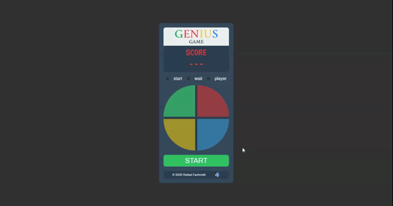

  

  
  
  
  

  <a href="https://rafaelfachinelli.github.io/geniusgame/">Live demo</a>

  <a href="#eye_speech_bubble-preview">Preview</a> •
  <a href="#information_source-about">About</a> •
  <a href="#memo-tasks">Tasks</a> •
  <a href="#arrow_forward-run">Run</a> •
  <a href="#hammer_and_wrench-technologies">Technologies</a> •
  <a href="#boy-author">Author</a> •
  <a href="#balance_scale-license">License</a>

---

## :eye_speech_bubble: Preview

|Desktop|
|:---:|
|<kbd></kbd>|

---

## :information_source: About

🧠 A memory game inspired by the classic GENIUS (Simon). The game lights up a random color sequence and the player repeats it; every round adds one more color, with no limit. It has sound effects with an on/off switch.

|Action|Desktop|Mobile|
|:---:|:---:|:---:|
|Select a color|<kbd>Mouse click</kbd>|:x:|

Built in 2020.

---

## :memo: Tasks

Click to view

|State|Task|
|:---:|:---|
|:heavy_check_mark:|Page structure|
|:heavy_check_mark:|Game style|
|:heavy_check_mark:|Random sequence generation|
|:heavy_check_mark:|Sequence repetition check|
|:heavy_check_mark:|Game start and game over|
|:heavy_check_mark:|Timing of the color flashes|
|:heavy_check_mark:|Sound with on/off switch|
|:heavy_check_mark:|Visual polish|

---

## :arrow_forward: Run

No build step. Open `index.html` in a browser, or play the [live demo](https://rafaelfachinelli.github.io/geniusgame/).

---

## :hammer_and_wrench: Technologies

|Web|
|:---:|
|[HTML5](https://developer.mozilla.org/en-US/docs/Web/HTML)|
|[CSS3](https://developer.mozilla.org/en-US/docs/Web/CSS)|
|[JavaScript](https://developer.mozilla.org/en-US/docs/Web/JavaScript)|

---

## :boy: Author

<a href="https://rafaelfachinelli.com">
  
   
  <b>Rafael Fachinelli</b>
</a>

Tech Lead and software engineer. Get in touch!

---

## :balance_scale: License

This project is under the [MIT license](./LICENSE).
